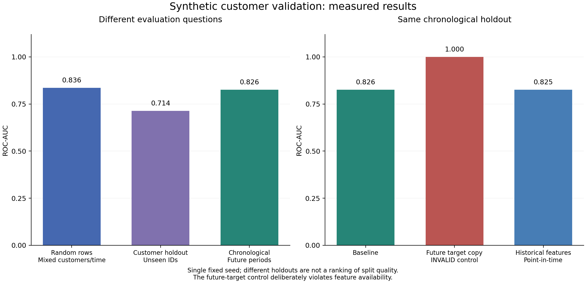

# Customer-level ML data leakage

A reproducible teaching experiment with entirely synthetic data, measured
results, automated checks and an executed notebook. No real customer,
employer or account information is included.

Companion article:
[Preventing Data Leakage in Customer-Level ML Datasets](https://kraiyani.github.io/blog/preventing-data-leakage-customer-level-ml/).
This is the intended publication URL; website publication is a separate step.

## Reproduce

Python 3.11 was used. Create and activate a virtual environment, then install
the pinned runtime requirements:

```powershell
python -m venv .venv
.\.venv\Scripts\Activate.ps1
python -m pip install -r requirements.txt
python -m src.train_evaluate
```

For the notebook, tests, formatting, linting and type checking:

```powershell
python -m pip install -r requirements-dev.txt
python -m scripts.build_notebook --execute
./scripts/commit-gate.ps1
```

On Unix, activate `.venv/bin/activate` and run `sh scripts/commit-gate`.
No external datasets, credentials, network API calls or notebook downloads
are needed after installing dependencies.

The requested command interface also supports a different configuration:

```powershell
python -m src.train_evaluate --seed 7 --customers 400 --periods 24
```

This replaces generated data and results. Do not select a seed because it
makes a preferred claim look better. The committed example uses seed 42;
these parameters were declared before inspecting its results.

## What is being predicted?

One row represents a customer at a prediction timestamp. The target is a
missed payment during the following fixed 30-day period. This recurrent
outcome avoids implying that already-churned customers remain active.

The default generator creates 300 customers and 24 periods, or 7,200 rows.
Each customer has a stable latent propensity that is not supplied directly
to the model. Activity, account tenure and payment load are available before
the snapshot. The label's event occurs 30 days after the snapshot and is
available two days later. The periods are fixed 30-day intervals, not
calendar months. The scenario is intentionally simple and constructed.

## Five experiments

| Case | Features | Evaluation question |
| --- | --- | --- |
| `random_rows` | Baseline + one-hot customer ID | Retrospective mixed-customer rows across the observation window |
| `customer_grouped` | Same baseline + one-hot customer ID | Retrospective generalization to entirely unseen customers |
| `chronological` | Same baseline + one-hot customer ID | Future periods, with training labels mature before fitting |
| `future_feature` | Chronological baseline + direct future target copy | Deliberately invalid negative control on the same chronological rows |
| `point_in_time` | Chronological baseline + historical rate/count | Available historical information on the same chronological rows |

The model is logistic regression with fixed `C=10`, `max_iter=2000` and
`tol=1e-8`. A scikit-learn pipeline fits numeric median imputation, scaling
and customer encoding only on training rows. Unknown IDs are ignored by
the encoder. Model parameters and the 0.5 accuracy threshold are not tuned
against the evaluation data.

Customer ID lets the model learn stable customer-specific effects when
those customers have appeared in training. That can be legitimate for
future known-customer prediction. It makes a mixed row holdout a poor
substitute for an unseen-customer test. The first three scores are not a
ranking of split quality on the same population.

The final three cases use identical chronological training and test rows.
The future-target control is explicitly rejected by the provenance audit,
then fitted deliberately to demonstrate the misleading score. That audit
failure is recorded rather than suppressed or described as a valid model.

## Read the actual results

- [Measured results table](results/RESULTS.md)
- [Metrics and structural audit counts](results/metrics.csv)
- [Per-row predictions](results/predictions.csv)
- [Configuration, package versions and source/data hashes](results/run_metadata.json)
- [Executed notebook](notebooks/leakage_experiment.ipynb)



In the seed-42 run, baseline ROC-AUC is about 0.836 for random rows,
0.714 for grouped customers and 0.826 for the chronological holdout. The
deliberate target copy reaches 1.000, while corrected history yields about
0.825. These are measured single-seed synthetic results. Additional valid
features did not beat the chronological baseline, and were not tuned to do so.

Average precision depends on class prevalence. The full CSV includes the
positive rate for each holdout as well as row and customer-overlap counts.
The grouped holdout has a different population from the row holdout.

## Time and provenance rules

- Both source event time and arrival time must be at or before the snapshot.
- A historical aggregate includes only events that have actually arrived.
- An event available exactly at the cutoff is included by the stated rule.
- A training label must be available by the model-fitting cutoff.
- The chronological fit excludes the final pre-holdout label window because
  its two-day reporting lag makes it unavailable when fitting begins.
- During the holdout, the historical feature store may incorporate outcomes
  from earlier periods after they arrive. The fitted model stays fixed.
- The grouped case enforces zero customer overlap. The chronological case
  intentionally allows existing customers to recur.

The retrospective random/grouped cases fit after all their training labels
are observed. They do not simulate forecasting from the earliest test time.
The `training_labels_after_test_start_count` column makes that distinction
visible; it must be zero for the chronological cases.

## Files

```text
data/                   Generated snapshots, events and historical features
notebooks/              Generated and executed demonstration notebook
results/                Generated metrics, predictions, chart and provenance
scripts/build_notebook.py   Source for regenerating the notebook
scripts/export_blog.py      Optional website export
scripts/commit-gate*        Quality gates for Unix and Windows
src/generate_data.py        Fixed-seed synthetic generator and configuration
src/feature_engineering.py  Backward as-of history and availability audit
src/validation_strategies.py Grouped, row and chronological holdouts
src/train_evaluate.py       Fixed-model experiment and CLI
src/reporting.py            CSV, chart and provenance generation
tests/                     Isolation, temporal and paired-holdout regressions
```

Do not edit generated CSVs, charts or the notebook directly. Regenerate them
from the source. Notebook execution repeats the saved run configuration from
`results/run_metadata.json`, or uses the default configuration when metadata
is absent. Its displayed chart is written under `.cache/` so execution does
not replace canonical results. Its source is `scripts/build_notebook.py`.

## Update the companion article

From this project's root, after regenerating results:

```powershell
python -m scripts.export_blog --website "PATH_TO/kraiyani.github.io"
```

The exporter fills the website's `templates/leakage-article.md` with the
measured table and configuration, and copies the metrics, chart and
provenance. Then run `node scripts/build-blog.cjs` in the website repository.
The old article slug remains a redirect to the longer canonical URL.

## Limits

This demonstration does not model real customer behaviour, establish a
production score, quantify statistical significance, or compare algorithms.
The stable customer effect and exact target copy are pedagogical choices.
There is one seed, one model family and one chronological holdout. There is
no hyperparameter search or claim that the same score ordering will occur
elsewhere. No model selection is performed on these evaluation sets.

The availability audit checks declared provenance. It cannot establish
that a real source system's metadata is truthful or complete. Entity
resolution, backfills, operational changes and feature semantics still
need domain review.

## References

- [scikit-learn: common pitfalls and leakage](https://scikit-learn.org/stable/common_pitfalls.html)
- [scikit-learn: grouped and temporal validation](https://scikit-learn.org/stable/modules/cross_validation.html)
- [scikit-learn: pipelines](https://scikit-learn.org/stable/modules/compose.html)

Source code and generated synthetic data are provided under the MIT licence.
